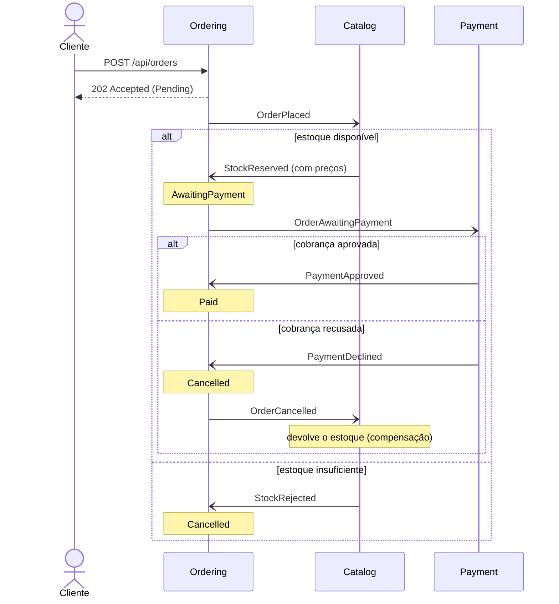
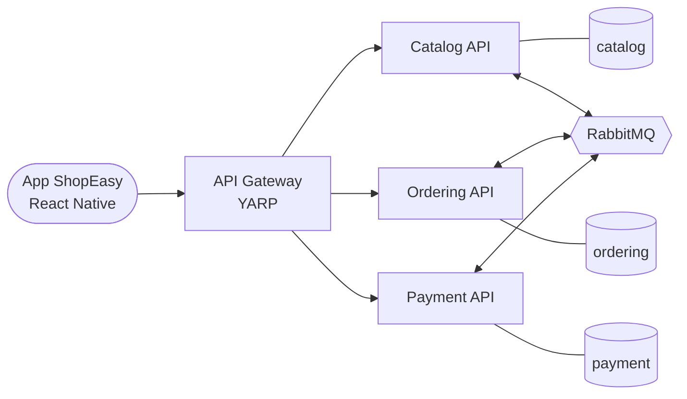

# ShopEasy

E-commerce completo: backend em microsserviços com **.NET 8** (catálogo, pedidos e pagamentos conversando por eventos no **RabbitMQ**, cada um com seu próprio banco **PostgreSQL**) e uma loja em **React Native (Expo)** que fecha pedidos de verdade contra ele.

O projeto existe para mostrar, em código pequeno o suficiente para ser lido inteiro, como Clean Architecture, DDD, CQRS e mensageria resolvem um problema real: fechar um pedido que depende de três serviços sem transação distribuída — e como um cliente mobile acompanha esse pedido assentando em cima dessa arquitetura, sem fingir que ela é síncrona.

## O fluxo de um pedido

O cliente recebe `202 Accepted` assim que o pedido é registrado. Estoque e pagamento são resolvidos depois, por uma saga coreografada, e o cliente acompanha pelo status do pedido.



## Arquitetura



O app ([`mobile/`](mobile)) é só mais um cliente HTTP do Gateway — a mesma API que o `curl` da seção abaixo usa. Ele segue a mesma lógica de camadas do backend (domínio puro, portas, casos de uso, apresentação); os detalhes estão no [README do app](mobile/README.md).

Cada serviço segue a mesma divisão em camadas, com as dependências apontando sempre para dentro:

| Camada | Responsabilidade | Depende de |
|---|---|---|
| `Domain` | Agregados, value objects, eventos e regras de negócio | nada além do núcleo compartilhado |
| `Application` | Casos de uso (comandos, queries e reações a eventos) e as portas que eles precisam | `Domain` |
| `Infrastructure` | EF Core, repositórios, gateway de pagamento, mensageria | `Application` |
| `Api` | Endpoints HTTP e composição da aplicação | `Infrastructure` |

```
backend/
├── src/
│   ├── BuildingBlocks/
│   │   ├── ShopEasy.BuildingBlocks                 # Entity, AggregateRoot, Money, Result, CQRS
│   │   ├── ShopEasy.BuildingBlocks.Infrastructure  # Outbox, RabbitMQ, unit of work, erros HTTP
│   │   └── ShopEasy.Contracts                      # Eventos de integração (contrato público)
│   ├── Services/
│   │   ├── Catalog/   Domain · Application · Infrastructure · Api
│   │   ├── Ordering/  Domain · Application · Infrastructure · Api
│   │   └── Payment/   Domain · Application · Infrastructure · Api
│   └── Gateway/ShopEasy.Gateway
└── tests/                                          # Testes de unidade por serviço

mobile/                                              # App React Native (Expo) — ver mobile/README.md
```

## Decisões de projeto

**DDD.** As regras moram nos agregados, não nos handlers. `Order` é dono da sua máquina de estados (`Pending → AwaitingPayment → Paid`, com `Cancelled` alcançável antes de `Paid`) e recusa transições inválidas. `Money` e `Address` são value objects imutáveis. A regra "um pedido é reservado por inteiro ou não é reservado", que envolve vários produtos, fica em um serviço de domínio (`StockAllocator`).

**CQRS.** Comandos carregam o agregado, aplicam a regra e salvam. Queries nunca passam pelo modelo de domínio: projetam direto do banco para o formato da resposta (`ICatalogQueries`, `IOrderQueries`), sem rastreamento de mudanças. O despacho é feito por um `Sender` próprio de ~70 linhas, que valida a requisição com FluentValidation antes de chamar o handler.

**Banco por serviço.** Nenhum serviço lê tabelas de outro. Quando o Ordering precisa do preço, ele vem no evento `StockReserved`, publicado por quem é dono do dado (Catalog), e é guardado no pedido como retrato daquele momento.

**Transactional outbox.** Um handler nunca publica direto no broker. O evento é gravado na tabela `outbox_messages` na mesma transação da mudança de negócio, e um `BackgroundService` o entrega ao RabbitMQ depois. Assim não existe "salvou o pedido mas perdeu o evento".

**Consumidores idempotentes.** A entrega é *at-least-once*, então toda reação tolera mensagem repetida: a reserva de estoque usa o id do pedido como identidade, o pagamento tem índice único por pedido e o agregado `Order` ignora transições que já aconteceram. Mensagens que falham três vezes vão para uma *dead-letter queue* em vez de travar a fila.

**Concorrência otimista.** `Product` usa a coluna `xmin` do PostgreSQL como token de versão: dois pedidos não levam a mesma última unidade; o segundo falha, é reprocessado e encontra o estoque já atualizado.

**Erros previsíveis não são exceções.** Casos de uso devolvem `Result`/`Error` ("produto não encontrado", "SKU duplicado"), que a API traduz para *problem details* (RFC 7807). Exceções ficam para invariantes violadas e falhas inesperadas.

**Portas e adaptadores.** A aplicação conhece apenas `IPaymentGateway`. O adaptador atual é um gateway simulado com regras determinísticas; trocar por um provedor real não toca em nenhum caso de uso.

## Como rodar

Pré-requisito: Docker.

```bash
docker compose up -d --build
```

| Endereço | O que é |
|---|---|
| http://localhost:8090 | **A loja** (build web do app React Native) |
| http://localhost:8080 | API Gateway (entrada única da API) |
| http://localhost:15672 | Painel do RabbitMQ (`shopeasy` / `shopeasy`) |
| `localhost:5440` | PostgreSQL (`shopeasy` / `shopeasy`) |

O jeito mais rápido de ver tudo funcionando é abrir **http://localhost:8090**, escolher um produto e fechar o pedido — o acompanhamento mostra a saga rodando em tempo real. Para rodar o app fora do Docker (hot reload, simulador, celular físico), veja o [README do app](mobile/README.md).

As migrações são aplicadas na subida e o catálogo recebe seis produtos de exemplo. O arquivo [`backend/requests.http`](backend/requests.http) tem as chamadas prontas; pela linha de comando:

```bash
# 1. Pegue o id de um produto
curl "http://localhost:8080/api/products?pageSize=5"

# 2. Faça o pedido (troque <PRODUCT_ID>)
curl -X POST http://localhost:8080/api/orders -H "Content-Type: application/json" -d '{
  "customerId": "7b0a3c0e-5a3f-4a53-9a57-0f6d1a2b3c4d",
  "shippingAddress": { "street": "Av. Beira Mar, 1000", "city": "Fortaleza", "state": "CE", "zipCode": "60165-121" },
  "paymentToken": "tok_visa",
  "items": [{ "productId": "<PRODUCT_ID>", "quantity": 1 }]
}'

# 3. Acompanhe o status (troque <ORDER_ID>)
curl http://localhost:8080/api/orders/<ORDER_ID>
```

Para reproduzir cada desfecho:

| Cenário | Como provocar | Resultado |
|---|---|---|
| Pedido pago | `paymentToken` qualquer, produto com estoque | `Paid`, estoque baixado |
| Sem estoque | Peça a "Cadeira Ergonômica Pro" (estoque 0) | `Cancelled`, nada reservado |
| Cartão recusado | `paymentToken` começando com `tok_declined` | `Cancelled`, estoque devolvido |
| Limite excedido | Total acima de R$ 10.000 | `Cancelled`, estoque devolvido |

## API

| Método | Rota | Descrição |
|---|---|---|
| `GET` | `/api/products?search=&page=&pageSize=` | Lista produtos, com busca e paginação |
| `GET` | `/api/products/{id}` | Detalhe do produto |
| `POST` | `/api/products` | Cadastra produto |
| `POST` | `/api/products/{id}/restock` | Repõe estoque |
| `POST` | `/api/orders` | Registra um pedido (`202 Accepted`) |
| `GET` | `/api/orders/{id}` | Detalhe e status do pedido |
| `GET` | `/api/orders?customerId=` | Pedidos de um cliente |
| `POST` | `/api/orders/{id}/cancel` | Cancela um pedido ainda não pago |
| `GET` | `/api/payments/order/{orderId}` | Pagamento processado para o pedido |

Cada serviço expõe `/swagger` e `/health` na sua própria porta, dentro da rede do Compose.

## Testes

```bash
cd backend && dotnet test
```

Os testes cobrem as regras dos agregados, o serviço de alocação de estoque, os casos de uso e as reações da saga, incluindo entrega duplicada de mensagens. Os testes do app (`cd mobile && npm test`) cobrem as regras do carrinho e a validação do formulário de entrega — ver [mobile/README.md](mobile/README.md#testes).

## Desenvolvimento local

Para rodar um serviço fora do Docker, suba só a infraestrutura e use o `appsettings.json`, que já aponta para ela:

```bash
docker compose up -d postgres rabbitmq
```

```bash
cd backend && dotnet run --project src/Services/Catalog/ShopEasy.Catalog.Api
```

Para criar uma migração (exemplo no Ordering):

```bash
cd backend && dotnet tool restore
```

```bash
dotnet ef migrations add NomeDaMigracao -p src/Services/Ordering/ShopEasy.Ordering.Infrastructure -s src/Services/Ordering/ShopEasy.Ordering.Api -o Persistence/Migrations
```

## Fora do escopo

Para manter o foco na arquitetura, ficaram de fora: autenticação (o `customerId` vem no corpo da requisição), integração com um provedor de pagamento real, estorno quando um pagamento é aprovado para um pedido já cancelado, observabilidade distribuída (tracing e métricas) e publicação do app nas lojas (ele roda como build web e via Expo em desenvolvimento).
